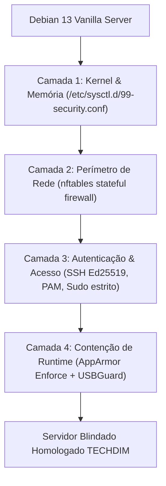

# 🛡️ Techdim Debian Hardening Framework
## Automação de Hardening e Contenção em Alta Segurança para Servidores Debian 13 (Trixie/Sid)


[](https://techdimbr.github.io/techdimbr/)
[](https://www.techdim.com.br)
[-D70A53.svg)](https://www.debian.org)
[](LICENSE)
[](https://www.cisecurity.org)
[](https://techdimbr.github.io/techdimbr/)

> **Framework modular em Ansible e Bash para aplicação determinística de hardening de kernel, isolamento estrito com AppArmor, firewall nftables e proteção contra mídias físicas maliciosas via USBGuard.**

---

## 🏛️ Visão Geral & Proposta de Valor

Servidores Linux recém-instalados possuem configurações padrão voltadas para conveniência e compatibilidade, mantendo módulos de kernel obsoletos, portas abertas e ausência de restrições de memória.

O **Techdim Debian Hardening Framework** transforma instâncias vanilla do Debian 13 em bastiões corporativos de alta segurança com um único comando, garantindo:
1. **Conformidade Auditável:** Alinhamento estrito com **CIS Debian Linux 12/13 Benchmark (Level 2 Server)** e diretrizes **DISA STIG**.
2. **Reprodutibilidade Determinística:** Implementado em Ansible sem agentes remotos, garantindo que 1 ou 1.000 servidores possuam a mesma assinatura de segurança idêntica.
3. **Zero Impacto em Produção:** Regras com validação prévia (`dry-run / check-mode`) e reversibilidade planejada.

---

## 🏗️ Arquitetura das 4 Camadas de Defesa



---

## ⚡ Início Rápido

### Pré-requisitos
- Debian 13 (Trixie/Sid) ou Debian 12 (Bookworm)
- Acesso root ou usuário com privilégios `sudo`
- Python 3.11+ e Ansible Core

### Execução Local
```bash
# 1. Clonar o repositório
git clone https://github.com/Techdimbr/techdim-debian-hardening-framework.git
cd techdim-debian-hardening-framework

# 2. Inicializar o ambiente e verificar integridade
./iniciar.sh

# 3. Executar o verificador de conformidade pré-hardening
python3 03_APLICACAO/src/compliance_checker.py --check
```

---

## 📜 Estrutura Canônica do Repositório

```text
techdim-debian-hardening-framework/
├── README DE INTRUCOES PRINCIPAIS.md  # 📌 Guia mestre para início do desenvolvimento
├── README.md                          # Este documento oficial
├── project.json                       # Metadados canônicos e vínculos
├── iniciar.sh                         # Bootstrap automatizado (permissão 755)
├── 00_AUDITORIA/                      # Verificação criptográfica SHA-256
├── 01_SOBRE_O_PROJETO/                # Casos de uso e fundamentação CIS
├── 02_COMO_USAR/                      # Guias de execução passo a passo
├── 03_APLICACAO/                      # Playbooks Ansible e verificador de conformidade
├── 04_INTELIGENCIA_DE_DESENVOLVIMENTO/# ADRs e prompts de agentes de IA
├── 05_VERSOES/                        # Histórico semântico de versões
└── 06_MIDIA/                          # Banner oficial e assets visuais
```

---

## 🛡️ Governança & Contato Corporativo
- **Autor:** Deivis Írio Mayer (Kether_1)
- **Entidade:** TECHDIM INOVA SIMPLES (I.S.) - ME · CNPJ 61.933.926/0001-24
- **Website Oficial:** [https://www.techdim.com.br](https://www.techdim.com.br)
- **Portal de Soluções:** [https://techdimbr.github.io/techdimbr/](https://techdimbr.github.io/techdimbr/)
